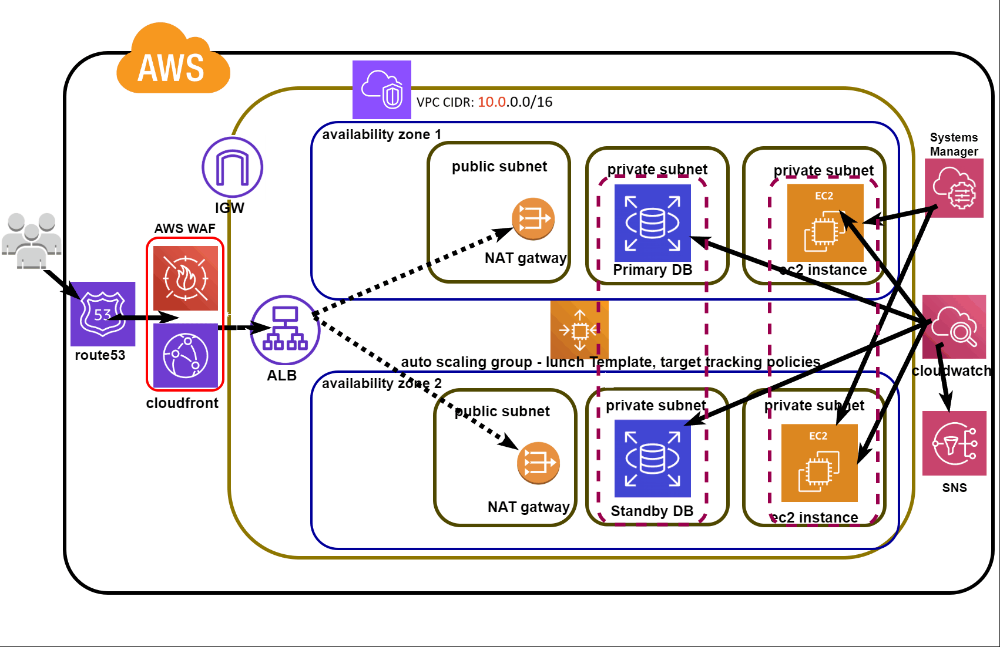

# Scalable Web Application on AWS

> **Project type:** AWS solution architecture and documentation  
> **Deployment status:** Architecture design only — the optional live deployment has not been completed.

A reference architecture for a web application designed for high availability and horizontal scaling using an Application Load Balancer, Amazon EC2 Auto Scaling, and Amazon RDS.

## Contents

- [Solution overview](#solution-overview)
- [Architecture diagram](#architecture-diagram)
- [Request flow](#request-flow)
- [AWS services](#aws-services)
- [Networking and security](#networking-and-security)
- [Availability and scaling](#availability-and-scaling)
- [Monitoring](#monitoring)
- [Cost considerations](#cost-considerations)
- [Repository structure](#repository-structure)
- [Project status](#project-status)

## Solution overview

The design separates the internet-facing entry point from the application and database tiers. The ALB routes requests to healthy EC2 instances managed by an Auto Scaling Group across two Availability Zones. The application tier connects to a private RDS database. CloudFront, S3, WAF, Route 53, Systems Manager, CloudWatch, and SNS support content delivery, security, administration, and monitoring.

## Architecture diagram



Editable diagram source: [`diagrams/architecture.mmd`](diagrams/architecture.mmd).

## Request flow

1. A user accesses the application domain. Route 53 is used when a custom domain is configured.
2. CloudFront receives requests and AWS WAF evaluates requests associated with the CloudFront distribution.
3. CloudFront serves cached static content from S3 where configured.
4. Dynamic application requests are forwarded to the internet-facing Application Load Balancer.
5. The ALB forwards requests to healthy EC2 instances registered in its target group.
6. The EC2 application instances access RDS through private network connectivity.
7. CloudWatch collects relevant metrics/logs and alarms can publish notifications through SNS.

## AWS services

| Service | Role in the design |
|---|---|
| Amazon VPC | Isolated network boundary for the application. |
| Availability Zones | Two separate AZs improve resilience to an AZ-level issue. |
| Public subnets | Host the internet-facing ALB and NAT Gateways if required. |
| Private application subnets | Host EC2 instances without direct public inbound access. |
| Private database subnets | Keep the RDS database off the public internet. |
| Internet Gateway | Provides internet connectivity to public subnet resources. |
| NAT Gateway | Enables private resources to initiate outbound internet connections when needed. |
| Application Load Balancer | Distributes requests across healthy application instances. |
| Target Group | Registers instances and performs health checks. |
| EC2 Launch Template | Defines the AMI, instance type, storage, IAM instance profile, and bootstrap settings. |
| EC2 Auto Scaling Group | Maintains desired capacity and scales according to configured policies. |
| Amazon RDS Multi-AZ | Managed relational database with standby/failover capability. |
| Amazon CloudFront | Edge delivery and caching for eligible content. |
| Amazon S3 | Stores static files such as images, CSS, and JavaScript. |
| AWS WAF | Filters web requests using a configured Web ACL. |
| Amazon Route 53 | DNS for a custom domain, if used. |
| AWS Systems Manager Session Manager | Administrative access without exposing SSH publicly, once configured. |
| Amazon CloudWatch | Metrics, logs, dashboards, and alarms. |
| Amazon SNS | Delivers alarm notifications to subscribed endpoints. |

## Networking and security

- Place the ALB in public subnets spanning two Availability Zones.
- Place EC2 instances in private application subnets spanning two Availability Zones.
- Place RDS in private database subnets and disable public accessibility.
- ALB security group: allow only the intended HTTP/HTTPS entry traffic.
- EC2 security group: allow the application port only from the ALB security group.
- RDS security group: allow the database port only from the application security group.
- Use an EC2 IAM instance profile with least-privilege permissions.
- Prefer Systems Manager Session Manager over public SSH access.
- Use HTTPS when a certificate and domain are configured.
- Public subnet route tables use the Internet Gateway for internet routes. Private application subnet route tables use a NAT Gateway only when outbound internet access is needed.
- Network ACLs are subnet-level stateless controls; avoid unnecessary complexity and allow return traffic.

## Availability and scaling

- Configure the ALB and Auto Scaling Group across two Availability Zones.
- Use a Launch Template for repeatable instance configuration.
- Configure target group health checks.
- Configure an Auto Scaling policy, such as target tracking, after choosing a suitable metric and target.
- Configure RDS Multi-AZ when required by the project specification.
- Use CloudFront for cacheable static content to reduce latency and origin requests.

## Monitoring

CloudWatch can collect EC2, ALB, and RDS metrics and application logs where configured. CloudWatch alarms can publish notifications to an SNS topic. The diagram shows the intended monitoring path; it does not claim that alarms or notifications have been deployed or tested.

## Cost considerations

The deployment is optional for this deliverable. NAT Gateways, ALB, RDS Multi-AZ, WAF, CloudFront usage, and public IPv4 addresses may incur charges. Review current regional pricing and account credits before creating resources, and remove billable resources after any optional demonstration.

## Repository structure

```text
scalable-web-app-aws/
├── README.md
├── diagrams/
│   ├── architecture.mmd
│   ├── architecture.gif
├── docs/
│   ├── architecture-decisions.md
│   └── security-and-networking.md
├── .github/
│   └── PULL_REQUEST_TEMPLATE.md
└── LICENSE
```

## Project status

**Completed in this repository:** architecture diagram and design documentation.

**Not claimed:** a deployed AWS environment, a live URL, load-test results, a verified scaling event, or an RDS failover test.
# scalable-web-app-aws
